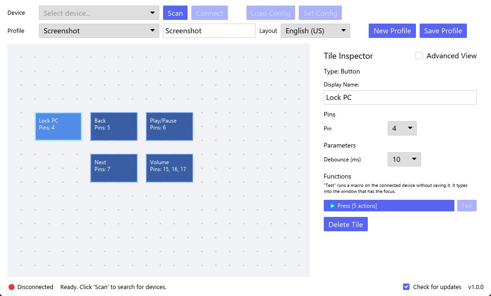
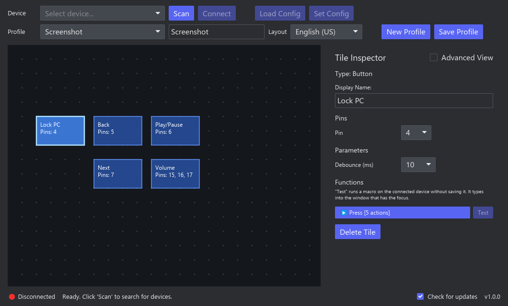

#  FlexPad

<!-- web:skip -->
[English](#english) · [Deutsch](#deutsch)
<!-- /web:skip -->

## English

FlexPad is a freely configurable macro pad based on the ESP32-S3. The board acts as a USB keyboard and media controller and runs key sequences when a button is pressed or an encoder is turned. A cross-platform desktop app written in Rust ([iced](https://iced.rs/)) lets you place buttons and rotary encoders on a canvas, assign GPIO pins and macros, and transfers the configuration to the device over USB serial. The firmware is written in Rust as well ([esp-hal](https://github.com/esp-rs/esp-hal), [Embassy](https://embassy.dev/)).

> Not affiliated with or endorsed by Espressif Systems.

<p>
  
  
</p>

### Features
- Up to 25 inputs on one ESP32-S3: push buttons and EC11 rotary encoders
- Macros made of key presses and releases, delays, media keys and text
- Visual editor: place tiles on a canvas, assign pins and build macros from presets or step by step
- Debounce time, encoder resolution and direction adjustable per tile
- Profiles stored locally and on the device; the device works without the app once configured
- No driver, no account, no network access except an optional update check (see [Privacy](#privacy))

### Hardware
| Part | Notes |
|---|---|
| ESP32-S3 board with native USB | Developed with an ESP32-S3 dev module with 16 MB flash and 8 MB octal PSRAM (N16R8) |
| Push buttons | One side to a GPIO pin, the other side to GND. Internal pull-ups are used, no resistors needed. |
| EC11 rotary encoder (optional) | Pins A and B to two GPIO pins, the middle pin C to GND. The push button of the encoder like a normal button. |

**Usable pins:** 1, 2, 4–18, 21, 38–42, 47, 48 (25 inputs). Left out on purpose: GPIO 0, 3, 45 and 46 (strapping pins), 19/20 (USB) and 33–37, which modules with octal PSRAM or octal flash (such as N16R8) use internally.

### Installation
Download the app from [Releases](../../releases) (releases named `FlexPad <version>`, tag `v<version>`). The app contains the matching firmware and installs or updates it on the board (see [Firmware](#firmware)). The firmware is also published on its own as `FlexPad firmware <version>` (tag `firmware-v<version>`). Changes are listed in the changelogs of the [app](flexpad-desktop/CHANGELOG.md) and the [firmware](flexpad-firmware/CHANGELOG.md).

#### App
**Windows:** run `FlexPad-<version>-windows-x64-setup.exe`. It installs for the current user without administrator rights (to `%LOCALAPPDATA%\Programs\FlexPad`); "Install for all users" installs to `C:\Program Files\FlexPad` and asks for administrator rights. Options: Start menu entry (on), desktop shortcut (off). Instead of the installer you can use the portable archive `…-windows-x64-portable.zip`.

**macOS:** open `…-macos-arm64.dmg` (Apple silicon) and drag FlexPad into the Applications folder.

**Linux:** on Debian, Ubuntu, Linux Mint and similar, install `flexpad_<version>_amd64.deb` (e.g. `sudo apt install ./flexpad_1.2.0_amd64.deb`); on Fedora, openSUSE and similar, install `flexpad-<version>-1.x86_64.rpm` (e.g. `sudo dnf install ./flexpad-1.2.0-1.x86_64.rpm`). Both add FlexPad to the application menu. For other distributions, extract `…-linux-x64.tar.gz` and start `flexpad`; it needs `libudev`. To access the USB serial port, your user must be in the group `dialout` (Debian, Ubuntu, Fedora) or `uucp` (Arch): `sudo usermod -aG dialout $USER`, then log in again.

The app is not signed, so the system may warn on the first start:
- **Windows:** SmartScreen → "More info" → "Run anyway"
- **macOS:** the app is not notarized by Apple. On the first start macOS refuses to open it; then choose System Settings → Privacy & Security → "Open Anyway" (on older versions: right-click the app → "Open"). This is needed only once.

Each download has a `.sha256` file to verify it.

#### Installer parameters
| Parameter | Effect |
|---|---|
| `/CURRENTUSER` | Install for the current user only (default) |
| `/ALLUSERS` | Install for all users (asks for administrator rights) |
| `/DIR="C:\Path"` | Installation folder |
| `/SILENT`, `/VERYSILENT` | Without wizard (with or without progress window) |
| `/SUPPRESSMSGBOXES` | No message boxes in silent mode |
| `/TASKS="desktopicon"` | Add a desktop shortcut; without the parameter there is none |
| `/NOICONS` | No Start menu entry |
| `/LOG="C:\Path\setup.log"` | Write a log file |

Example: `FlexPad-1.2.0-windows-x64-setup.exe /VERYSILENT /SUPPRESSMSGBOXES /TASKS="desktopicon"`

Profiles and settings are stored per user and are not set by the installer. Uninstalling removes the program and its shortcuts but keeps your profiles and settings (see [Privacy](#privacy) for the folders).

#### Firmware
The app contains the firmware of its own version and writes it itself, no extra tool needed:

- **Update:** if the connected FlexPad runs an older firmware, a bar above the canvas shows "Update firmware". The app restarts the FlexPad into its bootloader, writes the firmware and restarts it.
- **First installation or recovery:** hold **BOOT**, press **RESET**, release **BOOT** (or hold **BOOT** while plugging in the board), then click **Scan**. A bar above the canvas shows "Install firmware" for the board in bootloader mode.

Do not unplug the board while the progress bar is shown. If the board does not restart by itself afterwards, press **RESET** or unplug it briefly. The profile stored on the device is kept: only bootloader, partition table and app are written, and the image ends before the profile partition.

Alternatively, `FlexPad-firmware-<version>-esp32s3.bin` from the firmware release contains bootloader, partition table and firmware in one image for an ESP32-S3 with at least 8 MB flash. It is written with [espflash](https://github.com/esp-rs/espflash) (prebuilt downloads on its releases page, or `cargo install espflash`):

1. Put the board into download mode: hold **BOOT**, press **RESET**, release **BOOT**. If the FlexPad firmware is already running, sending `REBOOT_BOOTLOADER` over its serial port does the same.
2. `espflash write-bin --chip esp32s3 --no-stub --before no-reset --after no-reset --port <port> 0x0 FlexPad-firmware-<version>-esp32s3.bin`
3. Press **RESET** (or unplug the board briefly). The board then shows up as "FlexPad".

A profile already stored on the device is kept: the image ends before the profile partition.

### Usage
1. Connect the FlexPad via USB and start the app.
2. **Scan**, select the device and **Connect**.
3. Choose the **Keyboard layout** of the computer the pad is used with; the key names in the macro editor follow it.
4. **Load Config** reads the configuration stored on the device.
5. Add tiles with **Add Tile** (button or EC11 encoder), drag them into place and select one to edit it in the **Tile Inspector**:
   - **Pins**: choose the GPIO pin for each connection of the component (only free, usable pins are offered),
   - **Parameters**: debounce time, and for encoders the steps per detent and the direction,
   - **Functions** (e.g. press, turn right, turn left): open one to edit its macro,
   - in a function, build the macro from **Presets** or add actions (Press, Release, Delay, Media, Text) one by one. **Advanced View** shows the macro as raw JSON for editing.
   - **Test** next to a function runs its macro once on the connected device without saving anything; the answer (queued, busy or the reason for an error) is shown at the function. The macro types into the window that has the focus; text uses the keyboard layout of the profile stored on the device.
6. **Save Profile** stores the profile on your computer, **Set Config** sends it to the device.

Wiring test: while the app is connected, pressing a button or turning an encoder briefly highlights its tile on the canvas, and the status bar names the pin (e.g. "GPIO 12 pressed – not assigned" for a pin no tile uses).

### How it works
The firmware polls the configured pins every millisecond, debounces buttons, decodes encoders and runs the assigned macro as USB HID keyboard and consumer control (media keys) reports. The profile is stored as JSON in its own flash partition with two slots and a checksum, so it survives a restart and an interrupted save.

The app and the device talk over the USB serial port of the board (line-based text commands, each terminated with `\n`). The complete protocol and profile format are described in [docs/protocol.md](docs/protocol.md); overview:

| Command | Response |
|---|---|
| `GET_DEVICE_INFO` | `DEVICE_INFO:FlexPad,<serial number>,<firmware version>` |
| `GET_CONFIG` | `CONFIG_DATA:<profile JSON>` |
| `SET_CONFIG:<profile JSON>` | `CONFIG_SAVED`, or `CONFIG_ERROR:<reason>` (e.g. `unusable_pin:35`, `duplicate_pin:4`) without changing the stored profile |
| `RUN_MACRO:<function JSON>` | Runs a macro for testing, e.g. `RUN_MACRO:{"actions":[{"media":"mute"}]}`: `MACRO_QUEUED`, or `MACRO_ERROR:<reason>` |
| `REBOOT_BOOTLOADER` | `REBOOTING:bootloader`, then the board restarts in download mode for flashing |
| – | Sent by the device: `EVENT:PIN:<pin>:PRESSED`/`RELEASED` and `EVENT:ENCODER:<pin a>:RIGHT`/`LEFT` |

Each function of a tile holds a macro as a list of actions: `{"press":"<key>"}`, `{"release":"<key>"}`, `{"delay":<ms>}`, `{"media":"<action>"}` and `{"text":"<text>"}` (typed with the keyboard layout chosen in the profile; English (US) or German). Example (copy): `{"actions":[{"press":"ControlLeft"},{"press":"KeyC"},{"delay":50},{"release":"KeyC"},{"release":"ControlLeft"}]}`. Older profiles with comma-separated macro strings (`P:ControlLeft,P:KeyC,…`) are converted when loaded.

Key names describe the physical key position on a US keyboard, using the names of [`KeyboardEvent.code`](https://developer.mozilla.org/en-US/docs/Web/API/UI_Events/Keyboard_event_code_values) (`KeyA`, `Digit1`, `ControlLeft`, `Semicolon`, `IntlBackslash`, `NumpadAdd`, `F13` …). On a German layout, `Semicolon` therefore types `ö` and `KeyZ` types `y`. The app shows the keys with the labels of the keyboard layout chosen in the profile (e.g. `KeyY` as "Z" on a German layout); older names from earlier versions (`lctrl`, `ael`, `kp_1` …) are converted when a profile is loaded. Macros run in the background: the device keeps answering serial commands, and all keys are released when a macro ends.

### Privacy
- **The firmware never connects to the internet.** The app makes one optional request, the update check: at start and then every 24 hours while it runs, it sends an HTTPS GET request to `https://api.github.com/repos/TripleT3005/FlexPad/releases/latest` and receives the information about the latest release (version number and link), which is compared with the installed version; if it is newer, "Version x.y.z available" appears in the status bar at the bottom and opens the release page in your browser when clicked. Nothing is downloaded or installed. GitHub sees your IP address and the `User-Agent` `FlexPad/<version>`; nothing else is sent. Switch it off with **Check for updates** in the status bar (saved in the settings); then the app makes no request at all.
- The app only talks to serial ports on your computer. To find FlexPad devices it only opens USB serial ports whose USB serial number starts with `FlexPad-` (Espressif vendor ID `303A`) and asks them with `GET_DEVICE_INFO`; other devices are not touched. A scan also looks in the port list for an ESP32-S3 in bootloader mode (`303A:0009`) without opening it; that port is only opened when you click "Install firmware" or "Update firmware".
- Profiles and settings are stored per user: on Windows in `%APPDATA%\FlexPad`, on macOS in `~/Library/Application Support/FlexPad`, on Linux settings in `~/.config/flexpad` and profiles in `~/.local/share/flexpad` (or the folders set in `XDG_CONFIG_HOME` and `XDG_DATA_HOME`). Files from the folder `FlexPad` in the home directory used by earlier versions are moved there once on start. Position and size of the window belong to the computer and are kept in `window.json`: on Windows in `%LOCALAPPDATA%\FlexPad`, on macOS next to the settings, on Linux in `~/.local/state/flexpad` (or `XDG_STATE_HOME`). The device stores the complete profile you send to it, so **Load Config** shows the same profile on any computer. Older profiles are converted to the current format when loaded.
- The device identifies itself with a serial number derived from the chip's MAC address.

<!-- web:skip -->

### Building
#### Desktop app
Requires [Rust](https://www.rust-lang.org/tools/install) 1.88 or newer (edition 2024). On Linux, the serial port library also needs `libudev` (e.g. `sudo apt install libudev-dev pkg-config`).

```
cd flexpad-desktop
cargo run --release
```

`cargo test` runs the unit tests; CI checks formatting, `clippy` and tests on Windows, Linux and macOS.

Without further setup the app is built without firmware, and firmware updates are disabled. To embed a firmware image, point `FLEXPAD_FIRMWARE_IMAGE` to a merged image (built as in [Firmware](#firmware-1) with `espflash save-image --chip esp32s3 --merge --skip-padding --flash-size 8mb --partition-table partitions.csv <elf> <image>`), e.g. `FLEXPAD_FIRMWARE_IMAGE=/path/to/firmware.bin cargo build --release`. The release workflow does this with the firmware built in the same run.

#### Firmware
The firmware in `flexpad-firmware/` needs the Xtensa Rust toolchain and `espflash`:

```
cargo install espup espflash --locked
espup install --targets esp32s3
```

Afterwards, open a new terminal (Linux and macOS: `. ~/export-esp.sh`) and build:

```
cd flexpad-firmware
cargo build --release
cargo +stable test --lib --target <host target>   # protocol tests on your computer, e.g. x86_64-pc-windows-msvc
```

To flash, the board must be in download mode. If the FlexPad firmware is already running, send `REBOOT_BOOTLOADER` over the serial port; otherwise hold **BOOT**, press **RESET** and release **BOOT**. Then flash to the new port:

```
espflash flash --no-stub --before no-reset --after watchdog-reset --partition-table partitions.csv --port <port> target/xtensa-esp32s3-none-elf/release/flexpad-firmware
```

After flashing, press **RESET** (or unplug the board briefly) to start the firmware. `espflash` may report an error for the final `FlashEnd` step; the firmware is written anyway. The profile is stored in its own partition `flexpad` (64 KB) and is kept when a new firmware is flashed.

#### Releases
App and firmware have their own versions: `flexpad-desktop/Cargo.toml` with [flexpad-desktop/CHANGELOG.md](flexpad-desktop/CHANGELOG.md), and `flexpad-firmware/Cargo.toml` with [flexpad-firmware/CHANGELOG.md](flexpad-firmware/CHANGELOG.md). A test and the release workflow check that each version matches the newest section of its changelog. When a new version is merged into `main`, the release workflow publishes it: the app as `v<version>` (marked as latest release), the firmware as `firmware-v<version>`; the changelog section becomes the release notes. The app always contains the current firmware, so a new firmware version also needs a new app version, otherwise the release fails; a new app version alone does not need a firmware release. Changes without a new version are collected under `[Unreleased]`; a release fails while that section still has entries. Versions `0.x` and versions with a suffix like `1.1.0-beta.1` are published as pre-releases. Compatibility between app and firmware is decided by the protocol version in `GET_DEVICE_INFO` (see [docs/protocol.md](docs/protocol.md)), not by equal version numbers.

<!-- /web:skip -->

### License
[MIT](LICENSE)

## Deutsch

FlexPad ist ein frei konfigurierbares Makropad auf Basis des ESP32-S3. Das Board meldet sich als USB-Tastatur und Mediensteuerung und führt Tastenfolgen aus, wenn ein Taster gedrückt oder ein Encoder gedreht wird. Eine plattformübergreifende Desktop-App in Rust ([iced](https://iced.rs/)) platziert Taster und Drehencoder auf einer Arbeitsfläche, ordnet GPIO-Pins und Makros zu und überträgt die Konfiguration per USB-Seriell auf das Gerät. Auch die Firmware ist in Rust geschrieben ([esp-hal](https://github.com/esp-rs/esp-hal), [Embassy](https://embassy.dev/)).

> Keine Verbindung zu Espressif Systems und nicht von Espressif unterstützt.

<p>
  
  
</p>

### Funktionen
- Bis zu 25 Eingänge an einem ESP32-S3: Taster und EC11-Drehencoder
- Makros aus Drücken und Loslassen von Tasten, Pausen, Medientasten und Text
- Grafischer Editor: Kacheln auf einer Arbeitsfläche platzieren, Pins zuordnen und Makros aus Vorlagen oder Schritt für Schritt erstellen
- Entprellzeit, Encoder-Auflösung und Drehrichtung pro Kachel einstellbar
- Profile lokal und auf dem Gerät gespeichert; einmal eingerichtet, arbeitet das Gerät ohne die App
- Kein Treiber, kein Konto, keine Netzwerkzugriffe außer einer optionalen Update-Prüfung (siehe [Datenschutz](#datenschutz))

### Hardware
| Bauteil | Hinweise |
|---|---|
| ESP32-S3-Board mit nativem USB | Entwickelt mit einem ESP32-S3-Dev-Module mit 16 MB Flash und 8 MB Octal-PSRAM (N16R8) |
| Taster | Eine Seite an einen GPIO-Pin, die andere an GND. Die internen Pull-ups werden genutzt, Widerstände sind nicht nötig. |
| EC11-Drehencoder (optional) | Pins A und B an zwei GPIO-Pins, der mittlere Pin C an GND. Der Taster des Encoders wie ein normaler Taster. |

**Nutzbare Pins:** 1, 2, 4–18, 21, 38–42, 47, 48 (25 Eingänge). Bewusst ausgenommen: GPIO 0, 3, 45 und 46 (Strapping-Pins), 19/20 (USB) und 33–37, die Module mit Octal-PSRAM oder Octal-Flash (z. B. N16R8) intern nutzen.

### Installation
Die App gibt es unter [Releases](../../releases) (Releases mit Namen `FlexPad <Version>`, Tag `v<Version>`). Die App enthält die passende Firmware und installiert oder aktualisiert sie auf dem Board (siehe [Firmware](#firmware-2)). Die Firmware erscheint außerdem einzeln als `FlexPad firmware <Version>` (Tag `firmware-v<Version>`). Änderungen stehen in den Changelogs von [App](flexpad-desktop/CHANGELOG.md) und [Firmware](flexpad-firmware/CHANGELOG.md).

#### App
**Windows:** `FlexPad-<Version>-windows-x64-setup.exe` ausführen. Es installiert für den aktuellen Benutzer ohne Administratorrechte (nach `%LOCALAPPDATA%\Programs\FlexPad`); „Für alle Benutzer installieren“ installiert nach `C:\Program Files\FlexPad` und fragt nach Administratorrechten. Optionen: Startmenü-Eintrag (an), Desktop-Verknüpfung (aus). Statt des Installers geht auch das portable Archiv `…-windows-x64-portable.zip`.

**macOS:** `…-macos-arm64.dmg` (Apple Silicon) öffnen und FlexPad in den Ordner Programme ziehen.

**Linux:** Unter Debian, Ubuntu, Linux Mint und ähnlichen `flexpad_<Version>_amd64.deb` installieren (z. B. `sudo apt install ./flexpad_1.2.0_amd64.deb`), unter Fedora, openSUSE und ähnlichen `flexpad-<Version>-1.x86_64.rpm` (z. B. `sudo dnf install ./flexpad-1.2.0-1.x86_64.rpm`). Beide tragen FlexPad ins Anwendungsmenü ein. Für andere Distributionen `…-linux-x64.tar.gz` entpacken und `flexpad` starten; es braucht `libudev`. Für den Zugriff auf den USB-Seriell-Port muss der eigene Benutzer in der Gruppe `dialout` (Debian, Ubuntu, Fedora) bzw. `uucp` (Arch) sein: `sudo usermod -aG dialout $USER`, danach neu anmelden.

Die Anwendung ist nicht signiert, deshalb warnt das System beim ersten Start eventuell:
- **Windows:** SmartScreen → „Weitere Informationen“ → „Trotzdem ausführen“
- **macOS:** Die App ist nicht von Apple beglaubigt. Beim ersten Start verweigert macOS das Öffnen; dann unter Systemeinstellungen → Datenschutz & Sicherheit „Dennoch öffnen“ wählen (bei älteren Versionen: Rechtsklick auf die App → „Öffnen“). Das ist nur einmal nötig.

Zu jedem Download gibt es eine `.sha256`-Datei, um ihn zu prüfen.

#### Installer-Parameter
| Parameter | Wirkung |
|---|---|
| `/CURRENTUSER` | Nur für den aktuellen Benutzer installieren (Standard) |
| `/ALLUSERS` | Für alle Benutzer installieren (fragt nach Administratorrechten) |
| `/DIR="C:\Pfad"` | Installationsordner |
| `/SILENT`, `/VERYSILENT` | Ohne Assistent (mit oder ohne Fortschrittsfenster) |
| `/SUPPRESSMSGBOXES` | Keine Meldungsfenster bei stiller Installation |
| `/TASKS="desktopicon"` | Desktop-Verknüpfung anlegen; ohne den Parameter gibt es keine |
| `/NOICONS` | Kein Startmenü-Eintrag |
| `/LOG="C:\Pfad\setup.log"` | Protokolldatei schreiben |

Beispiel: `FlexPad-1.2.0-windows-x64-setup.exe /VERYSILENT /SUPPRESSMSGBOXES /TASKS="desktopicon"`

Profile und Einstellungen gelten pro Benutzer und werden vom Installer nicht gesetzt. Die Deinstallation entfernt Programm und Verknüpfungen, lässt Profile und Einstellungen aber stehen (Ordner siehe [Datenschutz](#datenschutz)).

#### Firmware
Die App enthält die Firmware ihrer eigenen Version und schreibt sie selbst, ohne zusätzliches Werkzeug:

- **Aktualisieren:** Läuft auf dem verbundenen FlexPad eine ältere Firmware, zeigt eine Leiste über der Arbeitsfläche „Update firmware“. Die App startet den FlexPad in seinen Bootloader neu, schreibt die Firmware und startet ihn wieder.
- **Erstinstallation oder Wiederherstellung:** **BOOT** gedrückt halten, **RESET** drücken, **BOOT** loslassen (oder **BOOT** beim Einstecken gedrückt halten), dann **Scan** klicken. Für das Board im Bootloader-Modus zeigt eine Leiste über der Arbeitsfläche „Install firmware“.

Das Board nicht abziehen, solange der Fortschrittsbalken zu sehen ist. Startet es danach nicht von selbst neu, **RESET** drücken oder es kurz abziehen. Das auf dem Gerät gespeicherte Profil bleibt erhalten: Geschrieben werden nur Bootloader, Partitionstabelle und App, und das Image endet vor der Profil-Partition.

Alternativ enthält `FlexPad-firmware-<Version>-esp32s3.bin` aus dem Firmware-Release Bootloader, Partitionstabelle und Firmware in einem Image für einen ESP32-S3 mit mindestens 8 MB Flash. Geschrieben wird es mit [espflash](https://github.com/esp-rs/espflash) (fertige Downloads auf dessen Release-Seite oder `cargo install espflash`):

1. Das Board in den Download-Modus bringen: **BOOT** gedrückt halten, **RESET** drücken, **BOOT** loslassen. Läuft bereits die FlexPad-Firmware, geht das auch, indem man über ihren seriellen Port `REBOOT_BOOTLOADER` sendet.
2. `espflash write-bin --chip esp32s3 --no-stub --before no-reset --after no-reset --port <port> 0x0 FlexPad-firmware-<Version>-esp32s3.bin`
3. **RESET** drücken (oder das Board kurz abziehen). Danach meldet sich das Board als „FlexPad“.

Ein bereits gespeichertes Profil bleibt erhalten: Das Image endet vor der Profil-Partition.

### Bedienung
1. FlexPad per USB anschließen und die App starten.
2. **Scan**, das Gerät auswählen und **Connect**.
3. Unter **Keyboard layout** das Tastaturlayout des Rechners wählen, an dem das Pad benutzt wird; die Tastennamen im Makro-Editor richten sich danach.
4. **Load Config** liest die auf dem Gerät gespeicherte Konfiguration.
5. Mit **Add Tile** Kacheln hinzufügen (Taster oder EC11-Encoder), an die gewünschte Stelle ziehen und zum Bearbeiten im **Tile Inspector** auswählen:
   - **Pins**: für jeden Anschluss des Bauteils den GPIO-Pin wählen (angeboten werden nur freie, nutzbare Pins),
   - **Parameter**: Entprellzeit, bei Encodern zusätzlich Schritte pro Raste und Drehrichtung,
   - **Funktionen** (z. B. Drücken, Rechts drehen, Links drehen): aufklappen, um das Makro zu bearbeiten,
   - in einer Funktion das Makro aus **Presets** übernehmen oder Aktionen (Press, Release, Delay, Media, Text) einzeln hinzufügen. **Advanced View** zeigt das Makro als rohes JSON zum Bearbeiten.
   - **Test** neben einer Funktion führt ihr Makro einmal auf dem verbundenen Gerät aus, ohne etwas zu speichern; die Antwort (in der Warteschlange, ausgelastet oder der Grund eines Fehlers) erscheint an der Funktion. Das Makro tippt in das Fenster, das den Fokus hat; Text verwendet das Tastaturlayout des auf dem Gerät gespeicherten Profils.
6. **Save Profile** speichert das Profil auf dem Rechner, **Set Config** überträgt es auf das Gerät.

Verdrahtungstest: Solange die App verbunden ist, hebt ein Tastendruck oder eine Encoder-Drehung die zugehörige Kachel kurz auf der Arbeitsfläche hervor, und die Statusleiste nennt den Pin (z. B. „GPIO 12 pressed – not assigned“ für einen Pin ohne Kachel).

### Funktionsweise
Die Firmware fragt die konfigurierten Pins jede Millisekunde ab, entprellt Taster, wertet Encoder aus und führt das zugeordnete Makro als USB-HID-Tastatur- und Mediensteuerungs-Reports aus. Das Profil liegt als JSON in einer eigenen Flash-Partition mit zwei Speicherplätzen und Prüfsumme; es übersteht so einen Neustart und ein unterbrochenes Speichern.

App und Gerät sprechen über den USB-Seriell-Port des Boards miteinander (zeilenbasierte Textbefehle, jeweils mit `\n` abgeschlossen). Das vollständige Protokoll und das Profilformat beschreibt [docs/protocol.md](docs/protocol.md) (auf Englisch); Überblick:

| Befehl | Antwort |
|---|---|
| `GET_DEVICE_INFO` | `DEVICE_INFO:FlexPad,<Seriennummer>,<Firmware-Version>` |
| `GET_CONFIG` | `CONFIG_DATA:<Profil-JSON>` |
| `SET_CONFIG:<Profil-JSON>` | `CONFIG_SAVED` oder `CONFIG_ERROR:<grund>` (z. B. `unusable_pin:35`, `duplicate_pin:4`), ohne das gespeicherte Profil zu ändern |
| `RUN_MACRO:<funktions-JSON>` | Führt ein Makro zum Testen aus, z. B. `RUN_MACRO:{"actions":[{"media":"mute"}]}`: `MACRO_QUEUED` oder `MACRO_ERROR:<grund>` |
| `REBOOT_BOOTLOADER` | `REBOOTING:bootloader`, danach startet das Board zum Flashen im Download-Modus neu |
| – | Vom Gerät gesendet: `EVENT:PIN:<pin>:PRESSED`/`RELEASED` und `EVENT:ENCODER:<pin a>:RIGHT`/`LEFT` |

Jede Funktion einer Kachel enthält ein Makro als Liste von Aktionen: `{"press":"<taste>"}` drücken, `{"release":"<taste>"}` loslassen, `{"delay":<ms>}` warten, `{"media":"<aktion>"}` Medientaste und `{"text":"<text>"}` Text tippen (mit dem im Profil gewählten Tastaturlayout; English (US) oder German). Beispiel (Kopieren): `{"actions":[{"press":"ControlLeft"},{"press":"KeyC"},{"delay":50},{"release":"KeyC"},{"release":"ControlLeft"}]}`. Ältere Profile mit kommagetrennten Makro-Strings (`P:ControlLeft,P:KeyC,…`) werden beim Laden umgewandelt.

Tastennamen beschreiben die physische Tastenposition auf einer US-Tastatur, mit den Namen von [`KeyboardEvent.code`](https://developer.mozilla.org/en-US/docs/Web/API/UI_Events/Keyboard_event_code_values) (`KeyA`, `Digit1`, `ControlLeft`, `Semicolon`, `IntlBackslash`, `NumpadAdd`, `F13` …). Bei deutschem Layout tippt `Semicolon` daher `ö` und `KeyZ` ein `y`. Die App zeigt die Tasten mit den Beschriftungen des im Profil gewählten Tastaturlayouts (z. B. `KeyY` als „Z“ bei deutschem Layout); ältere Namen früherer Versionen (`lctrl`, `ael`, `kp_1` …) werden beim Laden eines Profils umgestellt. Makros laufen im Hintergrund: Das Gerät beantwortet weiter serielle Befehle, und am Ende eines Makros werden alle Tasten losgelassen.

### Datenschutz
- **Die Firmware verbindet sich nie mit dem Internet.** Die App macht eine einzige optionale Anfrage, die Update-Prüfung: beim Start und danach alle 24 Stunden, solange sie läuft, sendet sie eine HTTPS-GET-Anfrage an `https://api.github.com/repos/TripleT3005/FlexPad/releases/latest` und erhält die Angaben zum neuesten Release (Versionsnummer und Link), die mit der installierten Version verglichen werden; ist sie neuer, erscheint in der Statusleiste unten „Version x.y.z available“, ein Klick öffnet die Release-Seite im Browser. Es wird nichts heruntergeladen oder installiert. GitHub sieht deine IP-Adresse und den `User-Agent` `FlexPad/<Version>`; sonst wird nichts gesendet. Abschalten lässt sich die Prüfung mit **Check for updates** in der Statusleiste (wird in den Einstellungen gespeichert); dann macht die App überhaupt keine Anfrage.
- Die App spricht nur mit seriellen Ports am eigenen Rechner. Um FlexPad-Geräte zu finden, öffnet sie nur USB-Seriell-Ports, deren USB-Seriennummer mit `FlexPad-` beginnt (Espressif-Hersteller-ID `303A`), und fragt sie mit `GET_DEVICE_INFO` ab; andere Geräte bleiben unberührt. Ein Scan sucht in der Portliste außerdem nach einem ESP32-S3 im Bootloader-Modus (`303A:0009`), ohne ihn zu öffnen; dieser Port wird nur geöffnet, wenn man „Install firmware“ oder „Update firmware“ klickt.
- Profile und Einstellungen liegen pro Benutzer unter Windows in `%APPDATA%\FlexPad`, unter macOS in `~/Library/Application Support/FlexPad`, unter Linux die Einstellungen in `~/.config/flexpad` und die Profile in `~/.local/share/flexpad` (bzw. in den Ordnern aus `XDG_CONFIG_HOME` und `XDG_DATA_HOME`). Dateien aus dem Ordner `FlexPad` im Benutzerverzeichnis, den frühere Versionen nutzten, werden beim Start einmalig dorthin verschoben. Position und Größe des Fensters gehören zum Rechner und liegen in `window.json`: unter Windows in `%LOCALAPPDATA%\FlexPad`, unter macOS neben den Einstellungen, unter Linux in `~/.local/state/flexpad` (bzw. `XDG_STATE_HOME`). Das Gerät speichert das komplette Profil, das man ihm schickt; **Load Config** zeigt daher an jedem Rechner dasselbe Profil. Ältere Profile werden beim Laden ins aktuelle Format übernommen.
- Das Gerät meldet sich mit einer Seriennummer, die aus der MAC-Adresse des Chips gebildet wird.

<!-- web:skip -->

### Bauen
#### Desktop-App
Voraussetzung ist [Rust](https://www.rust-lang.org/tools/install) 1.88 oder neuer (Edition 2024). Unter Linux braucht die Seriell-Bibliothek zusätzlich `libudev` (z. B. `sudo apt install libudev-dev pkg-config`).

```
cd flexpad-desktop
cargo run --release
```

`cargo test` führt die Unit-Tests aus; die CI prüft Formatierung, `clippy` und Tests unter Windows, Linux und macOS.

Ohne weitere Einstellung wird die App ohne Firmware gebaut, Firmware-Updates sind dann abgeschaltet. Um ein Firmware-Image einzubetten, `FLEXPAD_FIRMWARE_IMAGE` auf ein zusammengeführtes Image setzen (gebaut wie unter [Firmware](#firmware-3) mit `espflash save-image --chip esp32s3 --merge --skip-padding --flash-size 8mb --partition-table partitions.csv <elf> <image>`), z. B. `FLEXPAD_FIRMWARE_IMAGE=/pfad/zu/firmware.bin cargo build --release`. Der Release-Workflow macht das mit der Firmware, die im selben Lauf gebaut wird.

#### Firmware
Die Firmware in `flexpad-firmware/` braucht die Xtensa-Rust-Toolchain und `espflash`:

```
cargo install espup espflash --locked
espup install --targets esp32s3
```

Danach ein neues Terminal öffnen (Linux und macOS: `. ~/export-esp.sh`) und bauen:

```
cd flexpad-firmware
cargo build --release
cargo +stable test --lib --target <host-target>   # Protokoll-Tests auf dem Rechner, z. B. x86_64-pc-windows-msvc
```

Zum Flashen muss das Board im Download-Modus sein. Läuft bereits die FlexPad-Firmware, über den seriellen Port `REBOOT_BOOTLOADER` senden; sonst **BOOT** gedrückt halten, **RESET** drücken und **BOOT** loslassen. Dann auf den neuen Port flashen:

```
espflash flash --no-stub --before no-reset --after watchdog-reset --partition-table partitions.csv --port <port> target/xtensa-esp32s3-none-elf/release/flexpad-firmware
```

Nach dem Flashen **RESET** drücken (oder das Board kurz abziehen), damit die Firmware startet. `espflash` meldet beim letzten Schritt `FlashEnd` eventuell einen Fehler; die Firmware ist trotzdem geschrieben. Das Profil liegt in einer eigenen Partition `flexpad` (64 KB) und bleibt beim Flashen einer neuen Firmware erhalten.

#### Releases
App und Firmware haben eigene Versionen: `flexpad-desktop/Cargo.toml` mit [flexpad-desktop/CHANGELOG.md](flexpad-desktop/CHANGELOG.md) und `flexpad-firmware/Cargo.toml` mit [flexpad-firmware/CHANGELOG.md](flexpad-firmware/CHANGELOG.md). Ein Test und der Release-Workflow prüfen, dass jede Version zum neuesten Abschnitt ihres Changelogs passt. Landet eine neue Version auf `main`, veröffentlicht der Release-Workflow sie: die App als `v<Version>` (als neuestes Release markiert), die Firmware als `firmware-v<Version>`; der Changelog-Abschnitt wird zu den Release-Notizen. Die App enthält immer die aktuelle Firmware, eine neue Firmware-Version braucht also auch eine neue App-Version, sonst schlägt das Release fehl; eine neue App-Version allein braucht kein Firmware-Release. Änderungen ohne neue Version stehen unter `[Unreleased]`; ein Release schlägt fehl, solange dieser Abschnitt noch Einträge hat. Versionen `0.x` und Versionen mit Zusatz wie `1.1.0-beta.1` erscheinen als Vorabversion. Ob App und Firmware zusammenpassen, entscheidet die Protokollversion in `GET_DEVICE_INFO` (siehe [docs/protocol.md](docs/protocol.md)), nicht gleiche Versionsnummern.

<!-- /web:skip -->

### Lizenz
[MIT](LICENSE)
